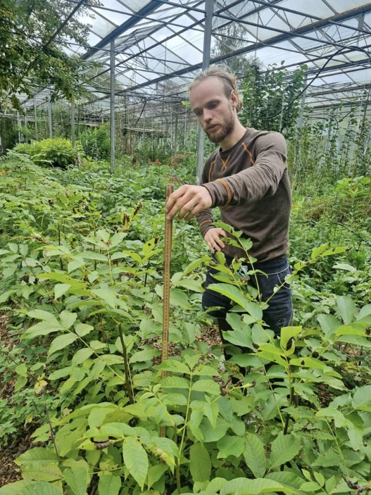

```{=html}
<link rel="stylesheet" href="assets/css/shop.css">
```

::: {.page-intro}
# Förna plantskola

::: {.closure-notice #plantskolan-stangd}
## Plantskolan är stängd

Vi tar inte längre emot beställningar via hemsidan. Ring gärna Fabian för ett gott snack om växter och odling. I samtalet får du veta vad som finns och kan göra en beställning.

[Ring Fabian: [0766-148318]{.phone-number}](tel:+46766148318){.cta-button}

Prislistor och bilder finns kvar här nedanför. Aktuella priser och tillgänglighet bekräftas av Fabian när du ringer.
:::

I vår plantskola odlar vi växter som passar långsiktiga, hållbara perenna odlingssystem. Vi samlar in fröer och tar sticklingar från områden nära oss, väljer ut friska och långlivade individer och arbetar med regenerativa metoder.
:::

::: {.split-grid}
::: {.content-card}
## Beställning via telefon

Plantskolan är stängd och det går inte att handla via hemsidan. Ring [Fabian på 0766-148318](tel:+46766148318) om du vill beställa eller prata om växterna i prislistan.

Tillgänglighet, pris och eventuell upphämtning kommer ni överens om i samtalet. Ring alltid innan ett besök.
:::
::: {.content-card}
{width=100% fig-alt="Valnöt i plantskolan"}
:::
:::

::: {.notice-box}
## Mängdrabatt

Rabatterna nedan finns kvar som information. Ring Fabian för att stämma av vad som gäller för din beställning.

- Köp 5: `10 %`
- Köp 10: `20 %`
- Köp 50: `30 %`
- Köp 100: `40 %`
:::

## Ätbara perenner

- Vi säljer främst vegetativt förökade plantor såsom rotklumpar, rotbitar och lökar.
- Större mängder kan förökas vid förfrågan.

```{=html}
<div class="catalog-table-wrap">
  <table class="catalog-table">
    <thead>
      <tr>
        <th scope="col">Växt</th>
        <th scope="col">Typ</th>
        <th scope="col">Pris</th>
        <th scope="col">Beställning</th>
      </tr>
    </thead>
    <tbody>
      <tr class="js-product-row" data-id="lungrot" data-name="Lungrot / Gode henriks målla" data-size="Rotklump" data-price-sek="50">
        <td>Lungrot / Gode henriks målla</td>
        <td>Rotklump</td>
        <td>50 kr</td>
        <td><div class="catalog-closed-action"><button type="button" class="catalog-closed-button" disabled aria-label="Köp stängt" aria-describedby="plantskolan-stangd">Stängt</button></div></td>
      </tr>
      <tr class="js-product-row" data-id="stravsolros" data-name="Strävsolros" data-size="Knöl" data-price-sek="20">
        <td>Strävsolros</td>
        <td>Knöl</td>
        <td>20 kr</td>
        <td><div class="catalog-closed-action"><button type="button" class="catalog-closed-button" disabled aria-label="Köp stängt" aria-describedby="plantskolan-stangd">Stängt</button></div></td>
      </tr>
      <tr class="js-product-row" data-id="libbsticka" data-name="Libbsticka" data-size="Rotklump" data-price-sek="50">
        <td>Libbsticka</td>
        <td>Rotklump</td>
        <td>50 kr</td>
        <td><div class="catalog-closed-action"><button type="button" class="catalog-closed-button" disabled aria-label="Köp stängt" aria-describedby="plantskolan-stangd">Stängt</button></div></td>
      </tr>
      <tr class="js-product-row" data-id="vallort" data-name="Vallört Bocking 14" data-size="Rotbit" data-price-sek="20">
        <td>Vallört, Bocking 14</td>
        <td>Rotbit</td>
        <td>20 kr</td>
        <td><div class="catalog-closed-action"><button type="button" class="catalog-closed-button" disabled aria-label="Köp stängt" aria-describedby="plantskolan-stangd">Stängt</button></div></td>
      </tr>
      <tr class="js-product-row" data-id="luftlok" data-name="Luftlök" data-size="Lök" data-price-sek="20">
        <td>Luftlök</td>
        <td>Lök</td>
        <td>20 kr</td>
        <td><div class="catalog-closed-action"><button type="button" class="catalog-closed-button" disabled aria-label="Köp stängt" aria-describedby="plantskolan-stangd">Stängt</button></div></td>
      </tr>
    </tbody>
  </table>
</div>
```

## Bärbuskar

Vi väljer att sälja bärbuskar utan namnsort och beskriver istället individernas karaktär i samband med beställning. Sortimentet finns i tre storlekar, `S-M-L`. Ring Fabian för aktuell tillgänglighet och frågor om framtida plantor.

## Fruktträd

- Vi säljer träd utan namnsort och kan även erbjuda grundstammar för egen ympning.
- Träden varierar i storlek och kvalitet och säljs i kategorierna `S-M-L`.
- Större mängder och sorter kan förökas vid förfrågan.

```{=html}
<div class="catalog-table-wrap">
  <table class="catalog-table">
    <thead>
      <tr>
        <th scope="col">Träd</th>
        <th scope="col">Storlek</th>
        <th scope="col">Pris</th>
        <th scope="col">Beskrivning</th>
        <th scope="col">Beställning</th>
      </tr>
    </thead>
    <tbody>
      <tr class="js-product-row" data-id="apple-grundstam-s" data-name="Äpple grundstam" data-size="S" data-price-sek="50">
        <td>Äpple (grundstam)</td>
        <td>S</td>
        <td>50 kr</td>
        <td>Klon, beräknad höjd 8-12 m</td>
        <td><div class="catalog-closed-action"><button type="button" class="catalog-closed-button" disabled aria-label="Köp stängt" aria-describedby="plantskolan-stangd">Stängt</button></div></td>
      </tr>
      <tr class="js-product-row" data-id="apple-grundstam-m" data-name="Äpple grundstam" data-size="M" data-price-sek="75">
        <td>Äpple (grundstam)</td>
        <td>M</td>
        <td>75 kr</td>
        <td>Klon, beräknad höjd 8-12 m</td>
        <td><div class="catalog-closed-action"><button type="button" class="catalog-closed-button" disabled aria-label="Köp stängt" aria-describedby="plantskolan-stangd">Stängt</button></div></td>
      </tr>
      <tr class="js-product-row" data-id="apple-grundstam-l" data-name="Äpple grundstam" data-size="L" data-price-sek="100">
        <td>Äpple (grundstam)</td>
        <td>L</td>
        <td>100 kr</td>
        <td>Klon, beräknad höjd 8-12 m</td>
        <td><div class="catalog-closed-action"><button type="button" class="catalog-closed-button" disabled aria-label="Köp stängt" aria-describedby="plantskolan-stangd">Stängt</button></div></td>
      </tr>
      <tr class="js-product-row" data-id="korsbarsplommon-s" data-name="Körsbärsplommon" data-size="S" data-price-sek="50">
        <td>Körsbärsplommon</td>
        <td>S</td>
        <td>50 kr</td>
        <td>Frösådd, beräknad höjd 4-8 m</td>
        <td><div class="catalog-closed-action"><button type="button" class="catalog-closed-button" disabled aria-label="Köp stängt" aria-describedby="plantskolan-stangd">Stängt</button></div></td>
      </tr>
      <tr class="js-product-row" data-id="korsbarsplommon-m" data-name="Körsbärsplommon" data-size="M" data-price-sek="75">
        <td>Körsbärsplommon</td>
        <td>M</td>
        <td>75 kr</td>
        <td>Frösådd, beräknad höjd 4-8 m</td>
        <td><div class="catalog-closed-action"><button type="button" class="catalog-closed-button" disabled aria-label="Köp stängt" aria-describedby="plantskolan-stangd">Stängt</button></div></td>
      </tr>
      <tr class="js-product-row" data-id="korsbarsplommon-l" data-name="Körsbärsplommon" data-size="L" data-price-sek="100">
        <td>Körsbärsplommon</td>
        <td>L</td>
        <td>100 kr</td>
        <td>Frösådd, beräknad höjd 4-8 m</td>
        <td><div class="catalog-closed-action"><button type="button" class="catalog-closed-button" disabled aria-label="Köp stängt" aria-describedby="plantskolan-stangd">Stängt</button></div></td>
      </tr>
      <tr class="js-product-row" data-id="plommon-grundstam-s" data-name="Plommon grundstam" data-size="S" data-price-sek="50">
        <td>Plommon (grundstam)</td>
        <td>S</td>
        <td>50 kr</td>
        <td>Klon, höjd och diameter ännu okända</td>
        <td><div class="catalog-closed-action"><button type="button" class="catalog-closed-button" disabled aria-label="Köp stängt" aria-describedby="plantskolan-stangd">Stängt</button></div></td>
      </tr>
      <tr class="js-product-row" data-id="plommon-grundstam-m" data-name="Plommon grundstam" data-size="M" data-price-sek="75">
        <td>Plommon (grundstam)</td>
        <td>M</td>
        <td>75 kr</td>
        <td>Klon, höjd och diameter ännu okända</td>
        <td><div class="catalog-closed-action"><button type="button" class="catalog-closed-button" disabled aria-label="Köp stängt" aria-describedby="plantskolan-stangd">Stängt</button></div></td>
      </tr>
      <tr class="js-product-row" data-id="plommon-grundstam-l" data-name="Plommon grundstam" data-size="L" data-price-sek="100">
        <td>Plommon (grundstam)</td>
        <td>L</td>
        <td>100 kr</td>
        <td>Klon, höjd och diameter ännu okända</td>
        <td><div class="catalog-closed-action"><button type="button" class="catalog-closed-button" disabled aria-label="Köp stängt" aria-describedby="plantskolan-stangd">Stängt</button></div></td>
      </tr>
      <tr class="js-product-row" data-id="paron-grundstam-s" data-name="Päron grundstam" data-size="S" data-price-sek="50">
        <td>Päron (grundstam)</td>
        <td>S</td>
        <td>50 kr</td>
        <td>Klon, beräknad höjd 6 m+</td>
        <td><div class="catalog-closed-action"><button type="button" class="catalog-closed-button" disabled aria-label="Köp stängt" aria-describedby="plantskolan-stangd">Stängt</button></div></td>
      </tr>
      <tr class="js-product-row" data-id="paron-grundstam-m" data-name="Päron grundstam" data-size="M" data-price-sek="75">
        <td>Päron (grundstam)</td>
        <td>M</td>
        <td>75 kr</td>
        <td>Klon, beräknad höjd 6 m+</td>
        <td><div class="catalog-closed-action"><button type="button" class="catalog-closed-button" disabled aria-label="Köp stängt" aria-describedby="plantskolan-stangd">Stängt</button></div></td>
      </tr>
      <tr class="js-product-row" data-id="paron-grundstam-l" data-name="Päron grundstam" data-size="L" data-price-sek="100">
        <td>Päron (grundstam)</td>
        <td>L</td>
        <td>100 kr</td>
        <td>Klon, beräknad höjd 6 m+</td>
        <td><div class="catalog-closed-action"><button type="button" class="catalog-closed-button" disabled aria-label="Köp stängt" aria-describedby="plantskolan-stangd">Stängt</button></div></td>
      </tr>
    </tbody>
  </table>
</div>
```

## Nötträd

- Frökälla för valnöt är Professorstaden i Lund, art `Juglans regia`.
- Frökälla för äkta kastanj är Baskemölla i Simrishamn, art `Castanea sativa`.
- Hassel förökas vegetativt på storfruktiga hasslar i fyra variationer och beräknas finnas i sortimentet våren 2027.

```{=html}
<div class="catalog-table-wrap">
  <table class="catalog-table">
    <thead>
      <tr>
        <th scope="col">Träd</th>
        <th scope="col">Storlek</th>
        <th scope="col">Pris</th>
        <th scope="col">Beskrivning</th>
        <th scope="col">Beställning</th>
      </tr>
    </thead>
    <tbody>
      <tr class="js-product-row" data-id="valnot-s" data-name="Valnöt" data-size="S" data-price-sek="50">
        <td>Valnöt</td>
        <td>S</td>
        <td>50 kr</td>
        <td>10-30 cm, 1 år, frösådd blandat frö</td>
        <td><div class="catalog-closed-action"><button type="button" class="catalog-closed-button" disabled aria-label="Köp stängt" aria-describedby="plantskolan-stangd">Stängt</button></div></td>
      </tr>
      <tr class="js-product-row" data-id="valnot-m" data-name="Valnöt" data-size="M" data-price-sek="75">
        <td>Valnöt</td>
        <td>M</td>
        <td>75 kr</td>
        <td>30+ cm, 1 år, selekterad frösådd från stort frö</td>
        <td><div class="catalog-closed-action"><button type="button" class="catalog-closed-button" disabled aria-label="Köp stängt" aria-describedby="plantskolan-stangd">Stängt</button></div></td>
      </tr>
      <tr class="js-product-row" data-id="valnot-l" data-name="Valnöt" data-size="L" data-price-sek="200">
        <td>Valnöt</td>
        <td>L</td>
        <td>200 kr</td>
        <td>30-40 cm, 2 år, frösådd blandat frö</td>
        <td><div class="catalog-closed-action"><button type="button" class="catalog-closed-button" disabled aria-label="Köp stängt" aria-describedby="plantskolan-stangd">Stängt</button></div></td>
      </tr>
      <tr class="js-product-row" data-id="valnot-xl" data-name="Valnöt" data-size="XL" data-price-sek="300">
        <td>Valnöt</td>
        <td>XL</td>
        <td>300 kr</td>
        <td>40+ cm, 2 år, frösådd blandat frö</td>
        <td><div class="catalog-closed-action"><button type="button" class="catalog-closed-button" disabled aria-label="Köp stängt" aria-describedby="plantskolan-stangd">Stängt</button></div></td>
      </tr>
      <tr class="js-product-row" data-id="kastanj-s" data-name="Äkta kastanj" data-size="S" data-price-sek="50">
        <td>Äkta kastanj</td>
        <td>S</td>
        <td>50 kr</td>
        <td>10-30 cm, frösådd blandat frö</td>
        <td><div class="catalog-closed-action"><button type="button" class="catalog-closed-button" disabled aria-label="Köp stängt" aria-describedby="plantskolan-stangd">Stängt</button></div></td>
      </tr>
      <tr class="js-product-row" data-id="kastanj-m" data-name="Äkta kastanj" data-size="M" data-price-sek="75">
        <td>Äkta kastanj</td>
        <td>M</td>
        <td>75 kr</td>
        <td>30+ cm, frösådd blandat frö</td>
        <td><div class="catalog-closed-action"><button type="button" class="catalog-closed-button" disabled aria-label="Köp stängt" aria-describedby="plantskolan-stangd">Stängt</button></div></td>
      </tr>
    </tbody>
  </table>
</div>
```

## Växtskydd och tillbehör

- Här säljs olika material på löpmeter eller per styck med arbetskostnad inräknad där det är relevant.
- Materialet är ofta begagnat och priset är justerat därefter.

```{=html}
<div class="catalog-table-wrap">
  <table class="catalog-table">
    <thead>
      <tr>
        <th scope="col">Produkt</th>
        <th scope="col">Pris</th>
        <th scope="col">Beställning</th>
      </tr>
    </thead>
    <tbody>
      <tr class="js-product-row" data-id="stalror" data-name="Stålrör till stolp" data-size="Per meter" data-price-sek="25">
        <td>Stålrör till stolp, 50 mm diameter x 4 mm gods</td>
        <td>25 kr / m</td>
        <td><div class="catalog-closed-action"><button type="button" class="catalog-closed-button" disabled aria-label="Köp stängt" aria-describedby="plantskolan-stangd">Stängt</button></div></td>
      </tr>
      <tr class="js-product-row" data-id="armeringsjarn" data-name="Armeringsjärn 16 mm" data-size="Per meter" data-price-sek="20">
        <td>Armeringsjärn 16 mm</td>
        <td>20 kr / m</td>
        <td><div class="catalog-closed-action"><button type="button" class="catalog-closed-button" disabled aria-label="Köp stängt" aria-describedby="plantskolan-stangd">Stängt</button></div></td>
      </tr>
      <tr class="js-product-row" data-id="viltstangsel" data-name="Viltstängsel 2 m" data-size="Per meter" data-price-sek="13">
        <td>Viltstängsel 2 m</td>
        <td>13 kr / m</td>
        <td><div class="catalog-closed-action"><button type="button" class="catalog-closed-button" disabled aria-label="Köp stängt" aria-describedby="plantskolan-stangd">Stängt</button></div></td>
      </tr>
      <tr class="js-product-row" data-id="odlingsror" data-name="Transparenta odlingsrör" data-size="Per styck" data-price-sek="60">
        <td>Transparenta odlingsrör för unga träd, ca 100 mm diameter</td>
        <td>60 kr / st</td>
        <td><div class="catalog-closed-action"><button type="button" class="catalog-closed-button" disabled aria-label="Köp stängt" aria-describedby="plantskolan-stangd">Stängt</button></div></td>
      </tr>
      <tr class="js-product-row" data-id="putsnat" data-name="Galvaniserat putsnät" data-size="Per meter" data-price-sek="45">
        <td>Galvaniserat putsnät 19 x 19 mm</td>
        <td>45 kr / m</td>
        <td><div class="catalog-closed-action"><button type="button" class="catalog-closed-button" disabled aria-label="Köp stängt" aria-describedby="plantskolan-stangd">Stängt</button></div></td>
      </tr>
      <tr class="js-product-row" data-id="ensilagebal" data-name="Ensilagebal möglig" data-size="Per styck" data-price-sek="300">
        <td>Ensilagebal, möglig</td>
        <td>300 kr / st</td>
        <td><div class="catalog-closed-action"><button type="button" class="catalog-closed-button" disabled aria-label="Köp stängt" aria-describedby="plantskolan-stangd">Stängt</button></div></td>
      </tr>
      <tr class="js-product-row" data-id="markkrok" data-name="Markkrok stor" data-size="Per styck" data-price-sek="15">
        <td>Markkrok stor, 300 mm lång och 16 mm tjock</td>
        <td>15 kr / st</td>
        <td><div class="catalog-closed-action"><button type="button" class="catalog-closed-button" disabled aria-label="Köp stängt" aria-describedby="plantskolan-stangd">Stängt</button></div></td>
      </tr>
    </tbody>
  </table>
</div>
```

## Grönsaker och livsmedel

- Odlingsyta: `200 kvm`
- Giftfritt, levande jord, god bevattning och hög mångfald
- Vi odlar större partier och ger prisförslag vid förfrågan
- Är du förädlare delar vi gärna på färdig produkt i utbyte

Årets grönsaker för `2026` är ännu inte publicerade. Hör gärna av dig om du vill veta vad som är på gång eller om du söker odling till restaurang, hushåll eller förädling.
